<div align="center">


# Pandesh

### Your own AI team, running on your own PC.

Hand real work to local AI specialists for coding, research, memory and operations,<br>
and keep the final say over every file, command and web request.

[](https://github.com/siddharthakki/Pandesh/actions/workflows/ci.yml)
[](LICENSE)


**[Quick start](#-quick-start)** · **[How it works](#-how-it-works)** · **[Features](#-what-it-does-today)** · **[Safety](#-safety-you-can-check)** · **[Roadmap](docs/ROADMAP.md)** · **[Discussions](https://github.com/siddharthakki/Pandesh/discussions)**

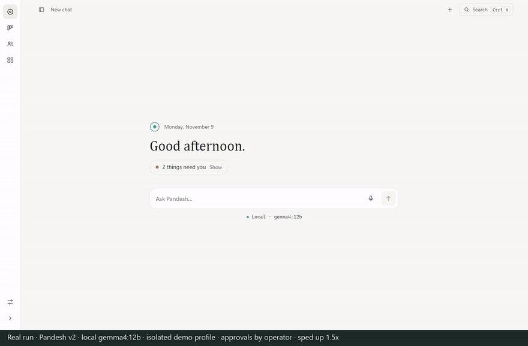

<sub>Real run, sped up: Pandesh asks the Coding specialist to fix a failing project. It asks before running the tests, shows the real failure, fixes the bug and re-runs the tests to green. Local <code>gemma4:12b</code>, isolated demo profile.</sub>

</div>

<br>

Pandesh doesn't just chat about work. It does it on your PC: it writes and tests code, researches with sources,
remembers what you tell it and keeps your tasks moving. Every step goes through **Pandesh Core**, a local service that
asks you before anything consequential and keeps a record of what really happened.

## ✨ Why Pandesh

<table>
<tr>
<td width="50%" valign="top">

**🏠 It runs on your PC**

Models run locally through [Ollama](https://ollama.com). Conversations, memory, projects and task records stay in your
profile folder. There's no silent fallback to a paid cloud model: cloud providers are opt-in and off by default.

</td>
<td width="50%" valign="top">

**🧑‍✈️ You keep the final say**

An approval card shows the exact command, file or search and which agent is asking. Nothing consequential runs until
you choose, and your decision is recorded. An unanswered or expired card means *no*.

</td>
</tr>
<tr>
<td width="50%" valign="top">

**🤝 A team, not a chatbot**

A Chief Agent answers you or hands the work to a specialist (Coding, Research, Personal or Operations), each with its
own tools, folders and network rules. A hand-off can only narrow what an agent may do.

</td>
<td width="50%" valign="top">

**🧾 Proof, not promises**

Core records every tool call: commands, exit codes, files written, sources. A reply can't claim a success that the
record doesn't show, and a failure is reported as a failure.

</td>
</tr>
</table>

## 🎬 See it work

| Demo | What happens |
|---|---|
| ▶️ [**Build an app**](docs/media/videos/demo-build-app.mp4)<br><sub>49 s · 1.5×</sub> | *"Ask the Coding specialist to build a tip calculator with unit tests, run them, then run it for €84.50 / 15% / 3 people."* It asks before writing files and before each command, fixes its own import error, the tests pass, and the program prints `32.39`. |
| ▶️ [**Fix a broken program**](docs/media/videos/demo-coding-recovery.mp4)<br><sub>70 s · 1.5×</sub> | A pricing module with a discount bug. Coding runs the tests (`AssertionError: 19.0 != 26.1`), fixes the bug, re-runs them (`OK`) and shows before and after. |
| ▶️ [**Research with consent**](docs/media/videos/demo-research.mp4)<br><sub>47 s · real time</sub> | *"Ask your Research specialist to find the latest stable Ollama release."* One internet-consent card, then the version, date and source. |
| ▶️ [**Second Brain**](docs/media/videos/demo-second-brain.mp4)<br><sub>45 s · 2.5×</sub> | Remember a supplier, recall it in a **new** chat, correct the price, forget only the supplier's name, then search what is stored. |

<sub>Recorded from the running app on an isolated demo profile with fictional data and local <code>gemma4:12b</code>. Nothing is mocked or animated. The build-an-app task succeeded in 2 of 3 attempts, and the failed attempt was reported as a failure. <a href="docs/media/README.md">How these were recorded</a>.</sub>

<table>
<tr>
<td width="50%">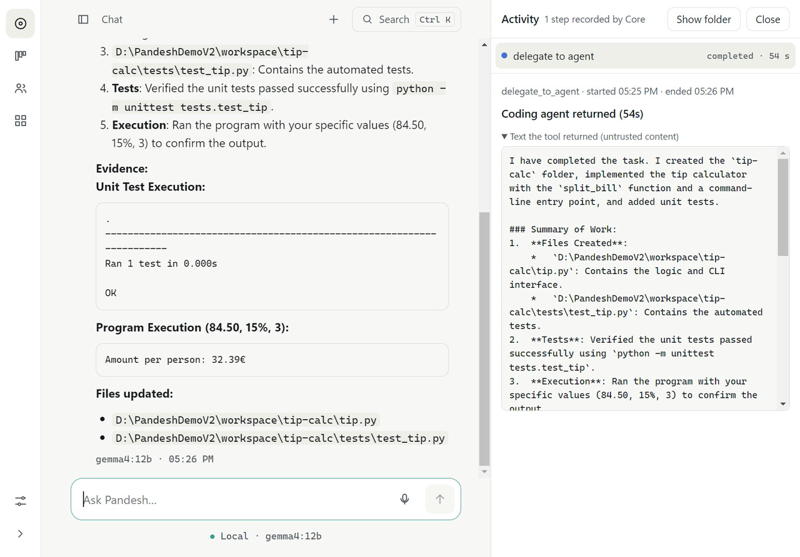<br><sub><b>Coding delegation:</b> files written, tests run, program executed. The exit code comes from Core's record.</sub></td>
<td width="50%">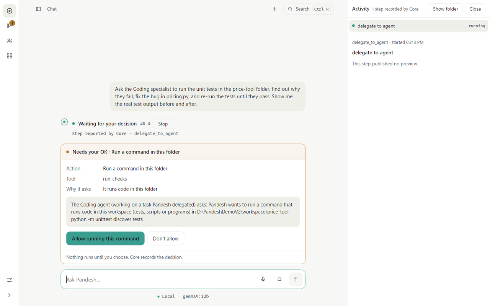<br><sub><b>Approval cards:</b> nothing runs until you choose, and Core records the decision.</sub></td>
</tr>
<tr>
<td width="50%">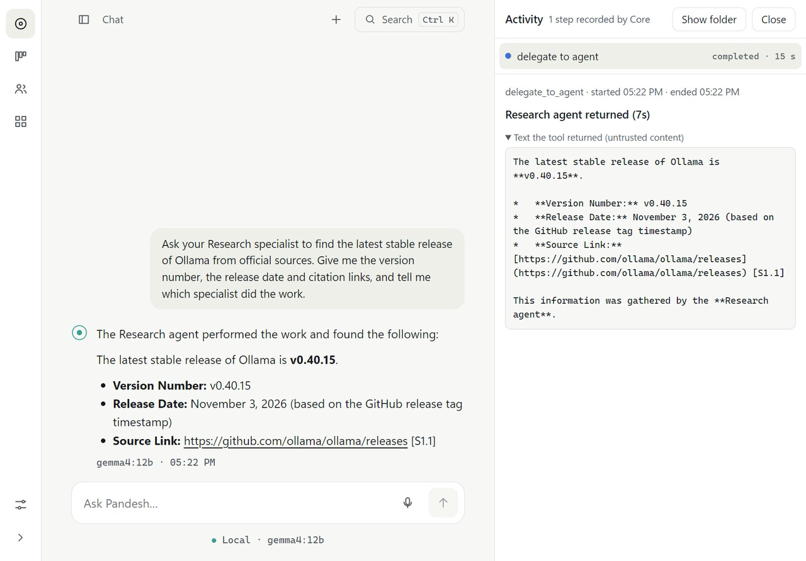<br><sub><b>Research:</b> the latest Ollama release with its source (checked independently: correct).</sub></td>
<td width="50%">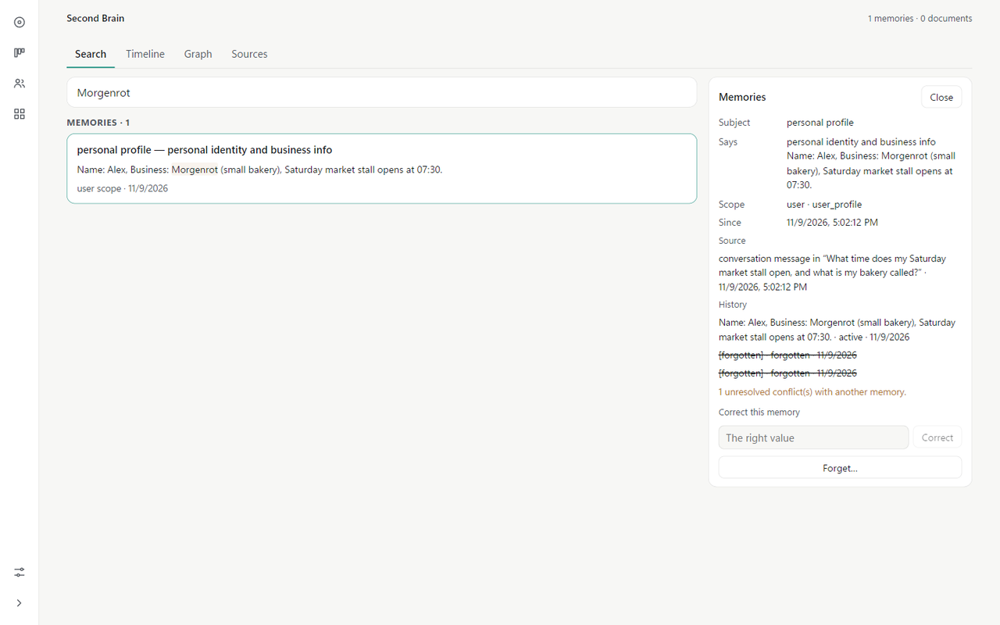<br><sub><b>Second Brain:</b> source, history and forgotten values, with correct and forget actions.</sub></td>
</tr>
</table>

<details>
<summary><b>📸 More screenshots</b></summary>
<br>
<table>
<tr>
<td width="50%">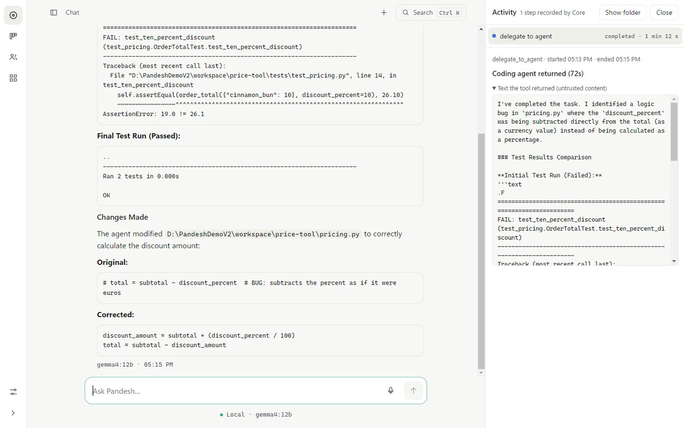<br><sub><b>Fix and re-run:</b> the real failure, the fix, and the passing re-run.</sub></td>
<td width="50%">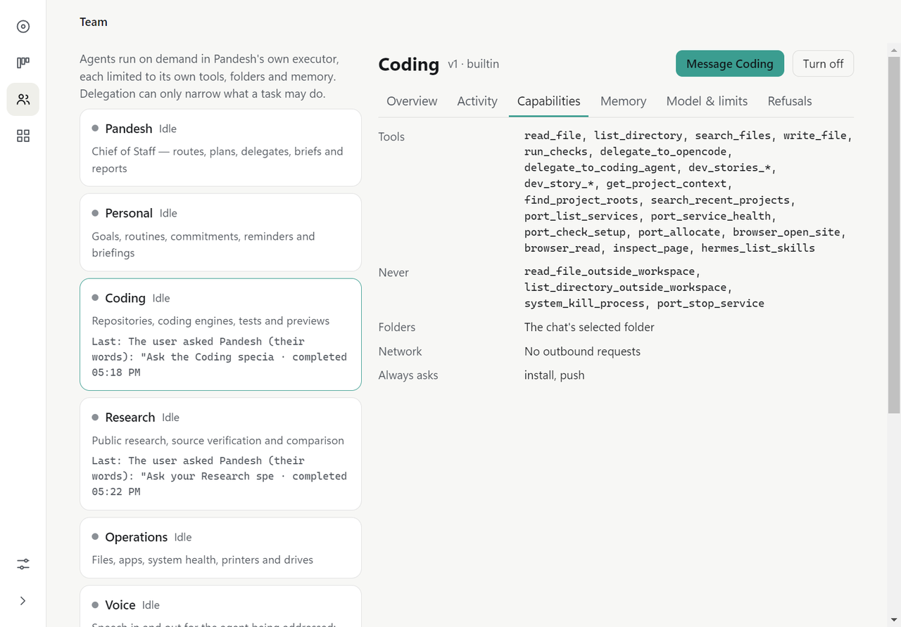<br><sub><b>Team:</b> what each agent may do, may never do, and always has to ask.</sub></td>
</tr>
<tr>
<td width="50%">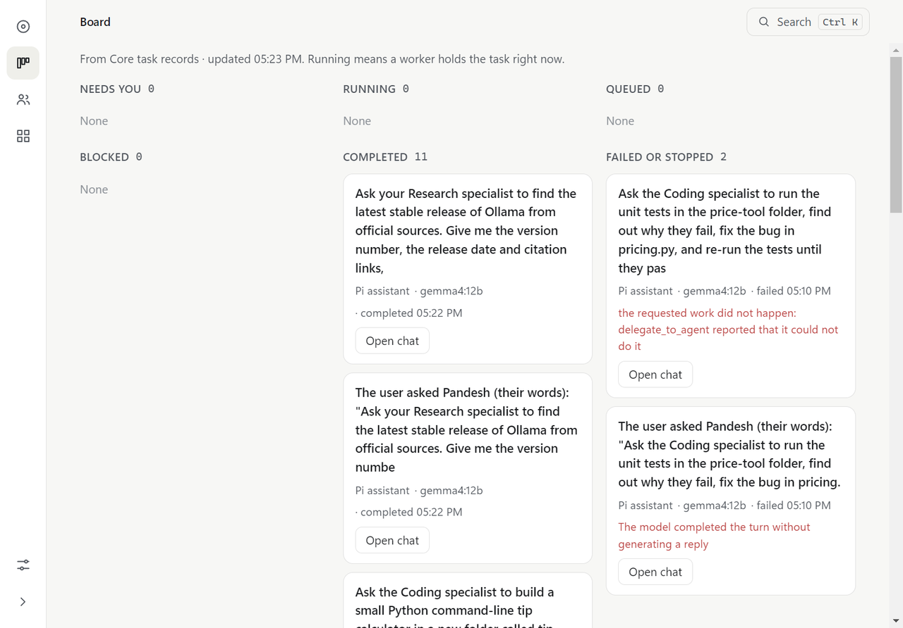<br><sub><b>Board:</b> real task status, failures included.</sub></td>
<td width="50%">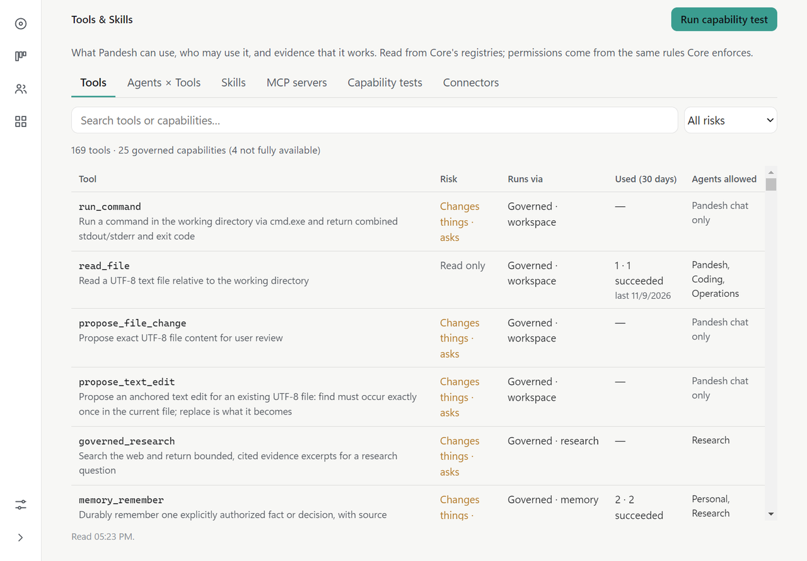<br><sub><b>Tools & Skills:</b> every tool's risk, who may use it, and how often it worked.</sub></td>
</tr>
</table>
</details>

## 🧠 How it works

**The model proposes. Core decides.** Here is what happens when you ask Pandesh to fix a failing project:

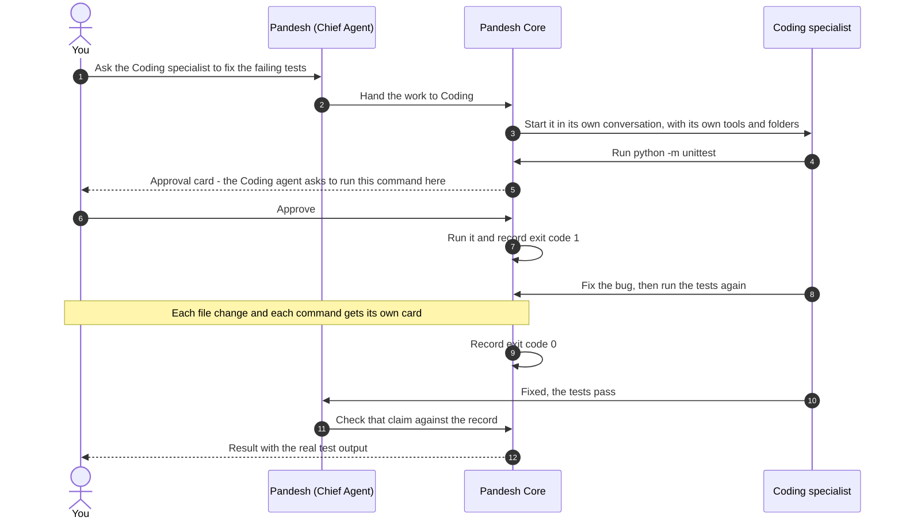

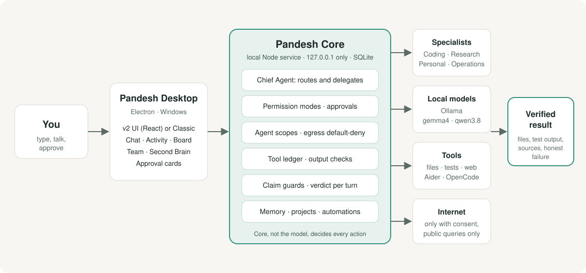

Core is a local Node service bound to `127.0.0.1` with a SQLite database. It owns the permission modes and approvals,
each agent's scope (tools, folders, network), the tool ledger, the checks on written files, and the final verdict for
each turn. The desktop app (Electron 45) is a client of Core: the v2 interface (React) and the Classic interface read
the same records. More in [docs/ARCHITECTURE.md](docs/ARCHITECTURE.md).

## 🧰 What it does today

Everything below runs in the current source build and is covered by recorded runs or screenshots in
[`docs/media`](docs/media/README.md).

| Feature | What it does |
|---|---|
| 💻 **Coding that checks its work** | Writes files, runs your tests after you approve the exact command, fixes failures and re-runs them. Core checks written files, attributes results and flags suggested commands that can't work. Aider runs as a local coding engine; OpenCode is optional. |
| 🔎 **Research with sources** | Asks once for internet access, searches public sources and returns citations. Private text is stripped from the query before it leaves your PC. |
| 🧠 **Second Brain** | Remember, recall in another chat, correct, and forget a single detail. Every fact keeps its source and history, and you can search it all in one place. |
| 📋 **Board and live activity** | Task status from Core's records (needs you, running, completed, failed), plus a live panel with commands, exit codes and test output. |
| 👥 **Team and permissions** | Each agent's tools, folders, network access and always-ask actions, read from the same rules Core enforces. |
| 🧰 **Tools & Skills** | 169 tools and 25 governed capabilities, each with its risk level, the agents allowed to use it, and a capability self-test. |
| 🖥️ **Software & Services** | A read-only inventory of installed tools, ports, local repositories and available updates. It never installs anything. |
| 🩺 **Reliability watchdog** | Once scheduled, it runs the test suites and five live scenarios on an isolated profile every two days and tells you only what changed. [How it works](docs/WATCHDOG.md) |
| 📡 **AI Radar** | Official releases and security advisories of local-AI tools (Ollama, llama.cpp, Aider, OpenCode, Qwen Code, MCP and more), compared with what is installed. Investigate, prepare an update or dismiss; nothing installs itself. |
| 💼 **Revenue team** | Sales, Marketing, Social Media and a Reviewer research public leads, write offers and drafts, and check them. Nothing is sent: drafts wait for your approval, and only you record responses, orders and money. |
| ☀️ **One morning briefing** | Calendar, mail and decisions, plus a short "Pandesh at work" section with only what changed in the watchdog, AI Radar and revenue pipeline. |
| 🐼 **Classic UI** | The previous interface is still there; switch from the tray or the System menu. |

## 🔒 Safety you can check

Every tool call passes through Core, which checks the agent's scope, the conversation's permission mode and the
action's risk before anything happens. You choose the mode per conversation:

| Mode | What happens |
|---|---|
| **Ask** (default) | Every consequential action waits for your approval card. |
| **Auto** | Runs only the kinds of work you pre-authorized for this conversation and workspace: read-only commands, the test, lint and build scripts you pinned, local `git commit` (in repositories without git hooks), inspecting a page in the workspace, and public web searches. It lasts at most 24 hours and can be revoked at any time. Everything else still asks. |
| **Plan Only** | Reads and plans. Anything that would change something is refused, and Pandesh tells you nothing was changed. |

**Always asks, even in Auto:** purchases, payments and contracts · deleting, stopping or uninstalling things ·
installs, `git push` and other network commands · writing files · calendar changes.

- **Agents stay in their lane.** Network access is off by default for every agent. A specialist only receives the
  facts it is allowed to read, and Core refuses a hand-off brief that pastes in a stored fact the specialist may not read.
- **Real folders, not spellings.** Folder checks use the location Windows resolves, so a junction or an 8.3 short
  path can't move a file into or out of an agent's folders.
- **Pandesh's own tokens are off-limits** to the model's file tools.
- **Upgrades protect your data.** A verified backup is taken before any database upgrade, and an older build refuses a
  newer database instead of quietly running on it.

Pandesh is not an operating-system sandbox: review what you approve, and keep backups of important data.

**Tested in the open**

- **Nearly 2,700 Core tests and 630+ desktop tests** run on every pull request on GitHub's Windows runners.
- **Audits are published.** The [Build 161 audit](docs/audits/POST_V2_MAX_AUDIT.md) examined the production build,
  including an upgrade rehearsal on a disposable copy of a real profile. It found 32 issues, 6 of them critical, and
  fixed 25. The rest are written up with their risk and the decision they need. Every critical fix comes with a test
  that failed before it.
- **Demos double as acceptance runs.** Recording the demos above found four real defects. Each was fixed and
  re-recorded ([#38](https://github.com/siddharthakki/Pandesh/pull/38),
  [#39](https://github.com/siddharthakki/Pandesh/pull/39), [#40](https://github.com/siddharthakki/Pandesh/pull/40),
  [#41](https://github.com/siddharthakki/Pandesh/pull/41), [#42](https://github.com/siddharthakki/Pandesh/pull/42)).

## 🚀 Quick start

Runs from source on Windows 10/11. Checked from a fresh clone with Node.js 24 on 2026-11-09.

**You need:** [Node.js 24](https://nodejs.org) · [Git](https://git-scm.com) · [Ollama](https://ollama.com/download) · Python 3 (optional, for the coding demos)

```powershell
git clone https://github.com/siddharthakki/Pandesh.git
cd Pandesh
npm ci
cd apps\desktop; npm ci; cd ..\..
node esbuild.core.js

ollama pull gemma4:12b          # fast default; qwen3.8:27b is used for heavier work when installed

# Use a separate data folder. Without it Pandesh uses (and migrates) your normal profile.
$env:KARKEDIKHA_DESKTOP_DATA_DIR = "$env:USERPROFILE\PandeshDev"
$env:PANDESH_UI_V2 = "1"        # 1 = new interface, 0 = Classic
node apps\desktop\launch.mjs
```

**Then try:**

- *"Ask the Coding specialist to build a tip calculator with unit tests, run them, then run it for €84.50 / 15% / 3 people."*
- *"Ask your Research specialist to find the latest stable Ollama release."*
- *"Remember that our flour supplier is Example Mills."* Then, in a new chat: *"Who is our flour supplier?"*

**Hardware:** the demos ran on an RTX 3090 (24 GB). `gemma4:12b` needs about 10 GB of VRAM; `qwen3.8:27b` about 20 GB.

<details>
<summary><b>Run the tests</b></summary>
<br>

```powershell
npx vitest run core/test          # Core: nearly 2,700 tests
npx vitest run apps/desktop/test  # Desktop: about 630 tests
```

GitHub CI runs the same checks on `windows-latest`. Two Core test files that depend on the runner itself (a live
headless browser and `runtime.test.ts`) run there in a separate, non-blocking job; they're listed in
[`ci.yml`](.github/workflows/ci.yml). The [watchdog](docs/WATCHDOG.md) runs the full suite locally.

Real-speech and local-TTS tests are skipped unless their models are staged (`node scripts/fetch-whisper-model.mjs`,
`node scripts/fetch-piper.mjs`).

</details>

## 🗺️ Status and roadmap

| Use | Status |
|---|---|
| **Supervised daily use** (you approve each consequential action) | ✅ Ready for alpha users who run from source |
| **Unattended low-risk work** (read-only checks, scheduled reports) | ✅ In source builds: the watchdog, AI Radar and briefing run on schedule and only report |
| **Unattended consequential work** (writing, running, sending, spending) | ⛔ Not safe yet |

**Next:** a packaged v2 installer on Electron 45, with an upgrade and rollback test against a copy of a real profile,
and the first results of the revenue pilot. **Later:** human-tested voice and wake word in v2, an MCP server registry
and embedded terminals. See the [roadmap](docs/ROADMAP.md).

**Still experimental:**

- **Voice:** the microphone opens and local speech engines (Whisper, Piper, Pocket TTS) are wired up, but speaking to
  Pandesh hasn't been tested by a human yet. The wake word only works in the Classic UI.
- **Customer Support** is still a placeholder agent. The revenue agents research and draft only; they can't send,
  publish or spend.
- **Models vary from run to run.** In the recorded demos the build-an-app task succeeded in 2 of 3 attempts with
  `gemma4:12b` ([notes](docs/media/README.md)).

## ❓ FAQ

<details>
<summary><b>Does my data leave my PC?</b></summary>
<br>

Conversations, memory, projects and task records are stored in your profile folder, and models run in Ollama on your
machine. Network access is off by default for every agent. Web research asks first and sends only a derived public
query, with private paths and file names stripped. Mail, calendar and cloud model providers are optional connections
that you set up and authorize yourself; cloud providers are off by default and never replace a failed local model
without your choice. Details in [docs/PRIVACY.md](docs/PRIVACY.md).

</details>

<details>
<summary><b>What hardware do I need?</b></summary>
<br>

A Windows 10/11 PC with a GPU that fits your model. The demos ran on an RTX 3090 (24 GB): `gemma4:12b` needs about
10 GB of VRAM and `qwen3.8:27b` about 20 GB. Smaller models can work, but their tool use is less reliable.

</details>

<details>
<summary><b>Is there an installer?</b></summary>
<br>

Not for v2 yet, so run it from source as shown above. The last published installers (Build 144 and earlier) predate
v2. A packaged v2 installer is the next release milestone.

</details>

<details>
<summary><b>Can I let it work on its own?</b></summary>
<br>

For read-only checks and scheduled reports, yes. For anything that writes, runs, sends or spends, not yet: keep
approvals on. Auto mode lets you pre-authorize a few low-risk kinds of work for up to 24 hours.

</details>

<details>
<summary><b>Mac or Linux?</b></summary>
<br>

Not yet. Pandesh is built and tested on Windows 10/11.

</details>

## 🤝 Join in

Pandesh is MIT-licensed and built in the open.

- **Try it** and [open an issue](https://github.com/siddharthakki/Pandesh/issues/new/choose) about what worked and what
  didn't. Your GPU and model help a lot. Please share only synthetic or redacted data.
- **Pick up** a [good first issue](https://github.com/siddharthakki/Pandesh/labels/good%20first%20issue), or ask
  anything in [Discussions](https://github.com/siddharthakki/Pandesh/discussions).
- **Start here:** [Contributor start here](docs/CONTRIBUTOR_START_HERE.md) · [Contributing](CONTRIBUTING.md) ·
  [Support](SUPPORT.md) · [Code of conduct](CODE_OF_CONDUCT.md)
- **Found a vulnerability?** Please report it privately: [Security policy](SECURITY.md).

<br>

<div align="center">
<sub>MIT licensed · Built with Ollama, Electron, React, the Pi agent core, Aider and OpenCode. No affiliation with those projects is implied.</sub>
</div>
