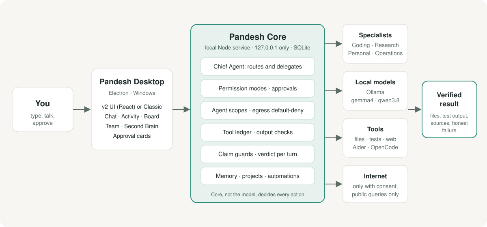

# Pandesh architecture

Pandesh has two processes that you run locally: the **desktop app** (Electron) and **Pandesh Core** (a Node.js service).
Core is the authority. The model proposes tool calls, and Core decides whether each one may run, asks you when it has
to, executes it, records the result and decides what the turn actually achieved.

## Components

| Part | Where | What it does |
|---|---|---|
| Desktop host | `apps/desktop/src` | Electron main process: window, tray, approvals, voice, updater, Classic/v2 switch. Starts Core and talks to it over a token-authenticated localhost API. |
| v2 interface | `apps/desktop/renderer-v2` | React UI: Chat, Activity (visual execution), Board, Team, Second Brain, Projects, Automations, Tools & Skills, Software & Services, Processes. Reaches Pandesh only through the preload bridge. |
| Classic interface | `apps/desktop/renderer` | The previous UI, still available and switchable. |
| Core API | `core/api` | HTTP + WebSocket on `127.0.0.1` with a per-launch token. Routes for conversations, agents, memory, projects, software, tools, processes. |
| Agent engine | `core/runtime/piAgentEngine.ts` | Runs a turn with the Pi agent core against Ollama's native API. Selects the tools offered for the request, applies the agent's scope, and runs the completion and verification passes. The system prompt stays identical between messages so Ollama reuses its cached prefix; what changes per message travels in a state block on the user's message (`turnState.ts`). How the prompt is built, and why: [agent harness playbook](agent-harness/PLAYBOOK.md). |
| Delegation | `core/domain/delegation.ts`, `core/runtime/agentRouting.ts` | The Chief Agent hands work to Coding, Research, Personal or Operations. A child attempt can only narrow what its parent may do. Child approvals appear in the parent chat. |
| Governed capabilities | `core/domain/capabilityDispatch.ts` | Memory, research, files, coding engines and other capabilities that need consent run through one dispatch path with durable approvals, exactly-once execution and redacted evidence. |
| Truth checks | `core/runtime/outputChecks.ts`, `taskCompletion.ts`, `actionClaims.ts` | Written files are parsed and their values grounded. Unfinished requested steps are pushed back to the model once. Suggested commands are checked against the files. Claims are matched to the tool ledger. |
| Storage | `core/db` | SQLite (`node:sqlite`) with 50 versioned migrations: conversations, attempts, tool invocations, approvals, memory facts with evidence and contradictions, projects, routines. |

## A turn, step by step

1. You send a message. The desktop host forwards it to Core as a request with a frozen permission mode
   (Ask / Auto / Plan Only).
2. Core picks the model (your choice, or Auto: `gemma4:12b` for quick turns, `qwen3.8:27b` for real work when installed)
   and the tool groups the request points at. Other tools can be added on request.
3. If you addressed a specialist ("Ask the Coding specialist…"), Core routes the hand-off itself and starts a child
   attempt under that agent's scope: its tools, workspace folders, memory scopes and network policy.
4. Each tool call goes through Core. Read-only calls run. Consequential calls (writing files, running code, going online,
   changing memory) wait for an approval card that names the exact action.
5. After the model stops, Core runs its checks: output checks on written files, the finish-what-was-asked pass, the
   suggested-command check and claim guards. Core then records a verdict (`verified`, `unverified`, `failed`,
   `conversational`) from the ledger, not from the model's own sentence.

## Privacy and safety model

- **Local by default.** Models run in Ollama on your PC, and data stays in your profile folder.
- **Egress default-deny.** Agents have no network access unless their policy allows it. Research asks once per task, and
  only a derived public query is sent, with private paths, file names and canaries stripped.
- **No silent cloud fallback.** Cloud providers are opt-in, and a failed local model is never replaced by a paid one
  without your choice.
- **Scoped agents.** Delegation can only narrow permissions. "Never" tools stay unavailable, and "always asks" actions
  (install, push) always ask.
- **Scoped memory.** Each agent recalls only the memory scopes its profile declares, and a hand-off passes on only the
  facts the receiving agent may read. Core refuses a hand-off brief that repeats a stored fact the receiver may not read.
- **Fail-closed approvals.** An unanswered or expired approval means no action.

## Known gaps

- `task` and `project` memory is not yet bound to a task or project id.
- Agent limits (`maxSteps`, `maxWallSeconds`) are declared per agent but not enforced.
- Private text in a web query is recognised by four-word overlap, so a two- or three-word private name in a short query
  is not caught, and the hand-off brief check is a word-pair heuristic. Internet-capable specialists don't receive
  user-scope memory or reminders.
- URL arguments of network tools are not checked for private text.

The full list, with the risk of each, is in the [Build 161 audit](audits/POST_V2_MAX_AUDIT.md#j-residual-risks-not-fixed-in-build-161).

See also: [UI v2 design documents](architecture/pandesh-ui-v2/), [acceptance runs](architecture/pandesh-ui-v2/real-world-challenge/README.md).
