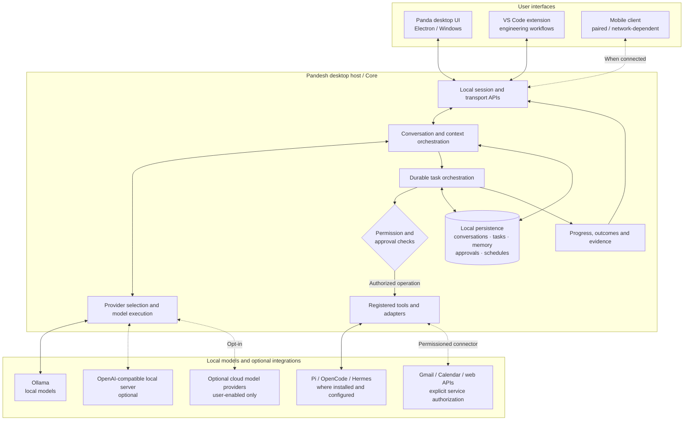
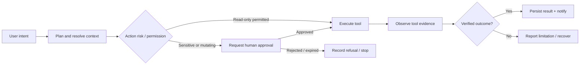

# Pandesh architecture

**Local-first, governed AI assistant for Windows.** This is a public architectural overview of the private development implementation and its design direction. It is **not** a claim that the entire application source is already published here or that every adapter is production-ready.

## System overview

Solid arrows indicate architectural relationships; dashed arrows indicate optional/configuration-dependent paths. This diagram is conceptual, **not** a measured topology of every deployed client.

## Governed task lifecycle

**Invariant:** model text is not proof of execution. Permission to attempt an action is not proof that it completed. A successful user-visible outcome requires evidence from the actual tool or connector.

## Responsibilities

| Component | Responsibility |
| --- | --- |
| Desktop shell | Application lifecycle, UI, sessions and presentation of actions/results |
| Core | Shared task state, conversations, scheduler, permission checks, persistence |
| Model/provider adapter | Request execution against configured Ollama or compatible provider; model availability is runtime-dependent |
| Tool adapter | Mediates file, diagnostics, coding engine and optionally external-service actions |
| Persistence | Local durable state; users must protect local profiles and backups |
| Connectors | Separate authentication and least-privilege source access; failures must be visible |
| Approval system | Human review for consequential external, filesystem, or system actions |

## Important boundaries

- **Local-first does not mean everything is offline.** Model inference through local Ollama can remain on the computer, while optional email, calendar, web and cloud integrations require network access and their own terms.
- **Least authority.** The app must not terminate unrelated host processes; process ownership and identity should be checked before shutdown or port management.
- **Approval isolation.** An operation approved for one scope must not authorize a different scope.
- **Cross-client continuity is a design goal.** Desktop, VS Code and paired mobile behavior must be tested individually; connectivity and network configuration affect availability.
- **Untrusted contributions.** Public pull requests only run on isolated GitHub-hosted CI; no contributor code is executed on a personal self-hosted runner.

## Status against public release

**Available publicly:** [Pandesh v0.1.1 Build 142](https://github.com/siddharthakki/Pandesh_Releases/releases/tag/v0.1.1-pandesh-alpha), a Windows alpha with reported sandbox and local-model acceptance.

**Development-preview UI:** screenshots in [the gallery](SCREENSHOTS.md) show v0.1.2 Build 143, which is not automatically the version in the currently published installer.

**Source availability:** public source publishing is staged pending credential remediation, an audited self-contained source snapshot, third-party notices and a clean build. See [publication gates](OPEN_SOURCE_STATUS.md).

## Further reading

[Roadmap](ROADMAP.md) · [Privacy and safety](PRIVACY.md) · [Screenshots](SCREENSHOTS.md) · [Third-party credits](https://github.com/siddharthakki/Pandesh_Releases/blob/main/THIRD_PARTY_NOTICES.md).
