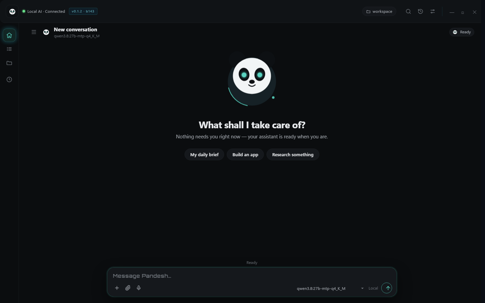
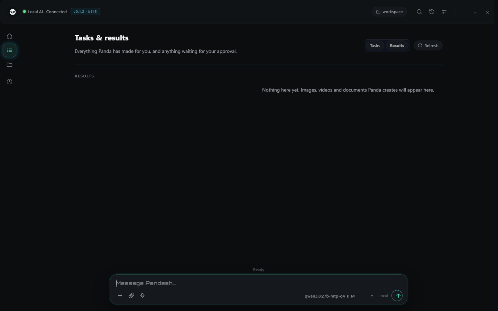

# Pandesh screenshots — development UI preview

These images show the **Pandesh v0.1.2 / Build 143 development UI**, not the [currently downloadable v0.1.1 / Build 142 alpha](https://github.com/siddharthakki/Pandesh_Releases/releases/tag/v0.1.1-pandesh-alpha).

**Demo content and synthetic records are present.** Screenshots show the interface, not independent evidence that a local model, real diagnostic run, file mutation or external connector produced every displayed response. The active model label and example response model names are not consistent in all screenshots. A verified end-to-end screen recording has not yet been uploaded.

The six gallery screenshots are now stored in **both** public repositories. Their Git blob hashes were verified during import from the existing release gallery.

## 1. Welcome to the Panda desktop

New conversation view, model selector and pinned composer.

## 2. Model/provider connections

Account and model provider settings. The example includes a sample private-network server address.

## 3. Example chat

Demonstration text includes model names that differ from the selected model shown in the UI; **do not treat it as verified model telemetry**.

## 4. Diagnostics presentation

Illustrative diagnostic response with sample hardware; **not an independently verified measurement** of a real PC.

## 5. Approval presentation

Example of a proposed file change and approval dialog; not confirmation that the edit executed.

## 6. Tasks and results

Development-preview results tab with compact artifact cards; not in the published v0.1.1 build.

## Video walkthrough

**Not published yet.** The media repository contains a storyboard but currently no MP4 asset attached to the public alpha release. Any future video should be captured in an isolated demo profile, show real tool results, avoid system tray/taskbar or private apps, and clearly label demo data.

[Getting started](https://github.com/siddharthakki/Pandesh_Releases/blob/main/docs/GETTING_STARTED.md) · [Architecture](ARCHITECTURE.md) · [Roadmap](ROADMAP.md)
