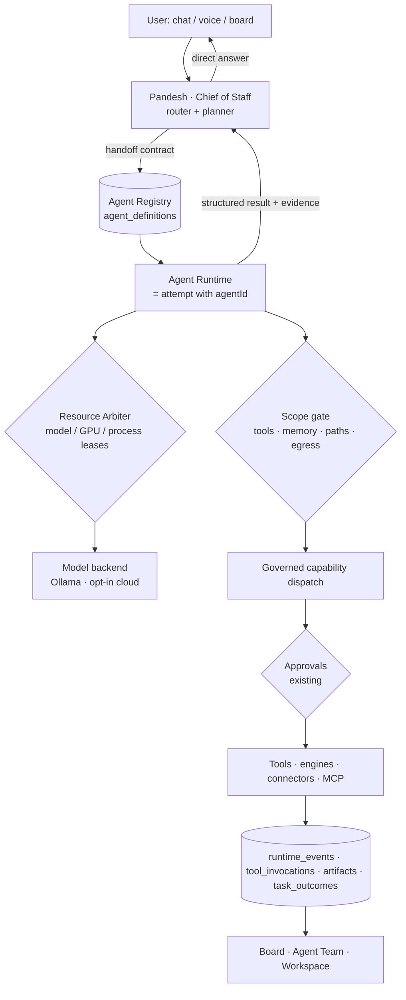
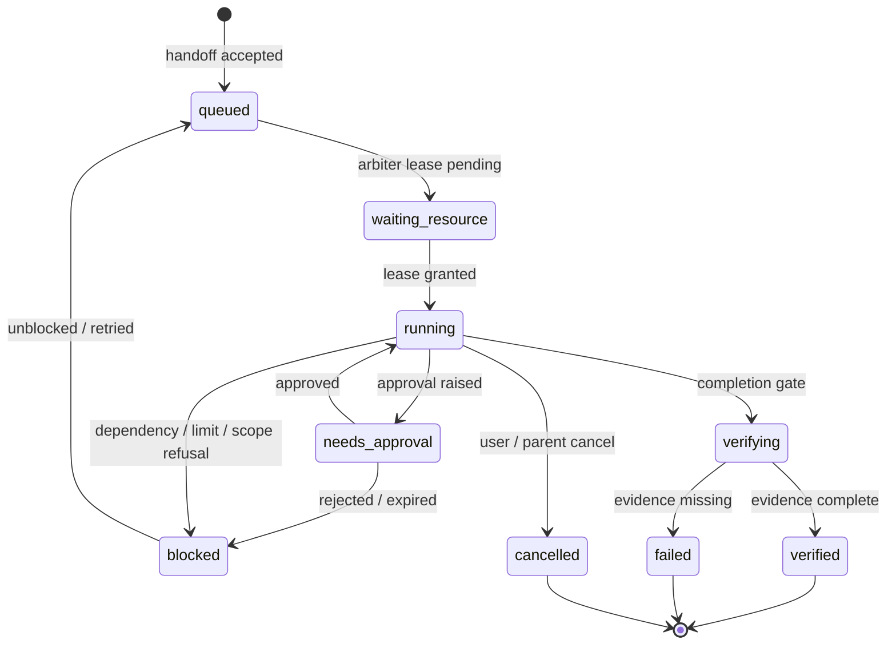

# Multi-agent architecture — Pandesh as chief of staff

## 1. Decisions

| # | Decision | Why |
|---|---|---|
| A1 | An **agent is a persistent definition + on-demand worker**, never a resident LLM process | Single GPU; ≈97 % of wait is model time; resident agents would fight for VRAM |
| A2 | Agent work runs through the **existing request → attempt → tool_invocation → approval pipeline**. An agent run is an attempt with `agentId` | No second task manager; every guard (claims, completion gate, approvals, recovery) applies for free |
| A3 | **Tool scope is enforced by Core** at dispatch, not by prompt text | Prompt-only personas are not specialists; also cuts prompt size (measured: 149 tools ≈ 29K tokens broke local tool calling; 113 tools worked — `docs/all-in-one-gaps.md`) |
| A4 | Memory scope uses existing `memory_facts.scopeType/scopeId` | No second memory database |
| A5 | Delegation is an explicit, typed **handoff contract** whose grant is a subset of the parent's grant | Prevents privilege laundering between agents |
| A6 | One **resource arbiter** in Core leases GPU/CPU-heavy work | Prevents concurrent model loads, ComfyUI vs LLM VRAM contention |
| A7 | Pandesh (Chief of Staff) is the only agent that talks to the user by default; specialists may be addressed directly | One voice; clear accountability |

## 2. Components



## 3. Agent Registry

New Core table (additive migration) — the only genuinely new persistence for agents:

```sql
CREATE TABLE agent_definitions (
  id TEXT PRIMARY KEY,               -- 'personal', 'coding', 'custom:<slug>'
  kind TEXT NOT NULL,                -- 'builtin' | 'custom'
  name TEXT NOT NULL,
  version INTEGER NOT NULL,          -- bumped on every change; runs record the version they used
  instructions TEXT NOT NULL,        -- identity + responsibilities (one block)
  capabilityIds TEXT NOT NULL,       -- JSON: governed capability ids (allowlist)
  toolDenylist TEXT NOT NULL DEFAULT '[]',
  skillIds TEXT NOT NULL DEFAULT '[]',
  mcpServerIds TEXT NOT NULL DEFAULT '[]',
  modelPolicy TEXT NOT NULL,         -- JSON: allowed providers/models, local-only flag, max cost/run
  memoryScopes TEXT NOT NULL,        -- JSON: [{scopeType, scopeId, access:'read'|'read_write'}]
  workspaceRoots TEXT NOT NULL DEFAULT '[]', -- filesystem roots; empty = none
  egressPolicy TEXT NOT NULL,        -- JSON: 'none' | domain allowlist | 'per-request approval'
  approvalPolicy TEXT NOT NULL,      -- JSON: categories always-ask; may only be STRICTER than global
  limits TEXT NOT NULL,              -- JSON: maxSteps, maxWallSeconds, maxToolCalls, maxConcurrentRuns, maxDelegationDepth
  enabled INTEGER NOT NULL DEFAULT 1,
  createdAt TEXT NOT NULL, updatedAt TEXT NOT NULL
);
```

Additive columns (nullable): `requests.agentId`, `requests.agentVersion`, `attempts.agentId`, `memory_facts` unchanged (scope already exists). Built-in definitions are seeded from code and can be overridden but not deleted; custom agents are rows created from a template in the UI (§8).

### 3.1 Scope gate (enforced in Core)

At tool exposure time (what the model sees) and again at dispatch time (what may run):

1. Tool ∈ agent `capabilityIds` and ∉ `toolDenylist` → else refuse with `agent_scope_denied` (recorded as a tool invocation outcome, never "succeeded").
2. Path arguments resolve inside `workspaceRoots` ∩ conversation workspace → else refuse.
3. Memory reads filtered by `memoryScopes`; writes only to scopes with `read_write`.
4. Egress through the existing egress proxy with the agent's domain policy.
5. Approval categories: union of global policy and agent policy (an agent can only add approvals).
6. Model: chosen by existing routing, constrained to `modelPolicy`; cloud only if the user enabled the provider **and** the agent allows it; no silent fallback (D9 rule).

## 4. Built-in specialists

All are definitions over existing tools unless marked **new tool**.

| Agent | Responsibility | Capabilities (allowlist, abridged) | Memory scope | Never without approval | Phase |
|---|---|---|---|---|---|
| **Pandesh (Chief of Staff)** | Route, plan, delegate, brief, report; owns the user conversation | Read-only everything, `routine_*`, `memory_recall`, delegation | `personal:*` read, own notes RW | Any delegation that grants write/egress beyond defaults | P2 |
| **Personal** | Goals, routines, commitments, deadlines, briefings, proposals | `commitments`, `everyday_*`, `routine_*`, `calendar_list/check`, `gmail_search/read`, `household_*`, `memory_*` | `personal`, `household` RW | Calendar writes, email drafts→send | P2 |
| **Voice** | Speech in/out, wake word, barge-in, language; a *channel* for other agents | Host speech, TTS, (later) telephony | none of its own; speaks on behalf of the addressed agent | Any outbound call (Phase 3) | P2 local / P3 phone |
| **Customer Support** | Inquiries, FAQ, status lookups, drafts, escalation, history | `business:<id>` knowledge, order lookup (**new**, Wish orders), drafts, ticket records (**new** `support_cases` or Wish ledger) | `business:<id>` only — **never personal** | Every outbound reply | P3 |
| **Sales** | Lead research, pipeline, proposals, follow-ups, CRM | `governed_research`, `wish_*` offers, proposal doc export, CRM (**new**, local) | `business:<id>` | Any external contact; no unsolicited outreach | P3 |
| **Social Media** | Drafts, images, calendar, scheduling, analytics | Drafts store (**new**), `comfyui_*`, `image_generate`, media, connectors (Metricool/networks, **new, opt-in**) | `brand:<id>` | Every publish, every DM, every reply | P2 drafts / P3 publish |
| **Marketing** | Campaigns, audience/competitor research, creative briefs; coordinates Social & Sales | `governed_research`, `browser_read`, docs export, delegation to Social/Sales | `brand:<id>`, `business:<id>` read | Paid spend of any kind (refused in P2) | P3 |
| **Coding** | Repos, engines (OpenCode, Hermes, Pi, Claude Code via Kandev), terminals, tests, previews | `delegate_to_opencode`, Kandev stories, `run_checks`, filesystem in workspace, ports, browser preview, process registry | `project:<id>` | Installs, pushes, writes outside workspace | P2 |
| **Research** | Public research, source verification, comparison, recommendations | `governed_research`, `browser_open_site/read`, `document_read` (granted) | `research` RW, others read-only by grant | Non-public queries (existing `publicQueryGuard`) | P2 |
| **Operations** | Filesystem, apps, system, workflows, printers, drives | `filesystem`, `system_*`, `printer_*`, `network-drive`, `pc-organizer`, `port_*`, window list/screenshot | `operations` | Every mutation (existing) | P2 |

## 5. Runtime model



These are **projections of existing attempt + approval + task_outcome state**, not a new status column. Mapping lives in one pure function `agentRunState(attempt, approvals, outcome, lease)` shared by Board and Agent Team.

- **Workers on demand**: a run loads the agent definition, builds a scoped tool list, takes an arbiter lease, executes in the existing executor (Pi / native loop), releases the lease. Idle agents cost nothing.
- **Timeouts/limits** from `limits`; exceeding a limit yields `blocked` with the reason, never a fabricated summary.
- **Recovery**: existing boot reconciliation + `attempt_loop_continuations`; a run interrupted by restart is `blocked: interrupted` until resumed or cancelled — never silently re-run if it had external effects (mutation ledger check).
- **Structured result** (required for every agent run, stored in `task_outcomes`):

```json
{ "agentId": "coding", "objective": "...", "status": "verified|failed|blocked|partial",
  "summary": "one headline sentence", "evidence": [{"kind":"tool_invocation","id":"..."},{"kind":"artifact","id":"..."}],
  "artifacts": ["art_..."], "changedFiles": ["..."], "blocker": null, "nextAction": null,
  "notDone": ["what was NOT done, explicitly"] }
```

## 6. Delegation and handoff contract

New table (additive) — a delegation is a child request linked to the parent attempt:

```sql
CREATE TABLE agent_handoffs (
  id TEXT PRIMARY KEY,
  parentAttemptId TEXT NOT NULL REFERENCES attempts(id),
  childRequestId TEXT REFERENCES requests(id),
  fromAgentId TEXT NOT NULL, toAgentId TEXT NOT NULL,
  brief TEXT NOT NULL,                  -- objective + success criteria + constraints
  inputRefs TEXT NOT NULL DEFAULT '[]', -- artifact/memory/message ids, not copied content
  grant TEXT NOT NULL,                  -- JSON scope ⊆ parent effective scope ∩ child definition
  dedupeKey TEXT NOT NULL,              -- hash(toAgent, normalized objective, inputRefs)
  depth INTEGER NOT NULL,               -- parent depth + 1
  status TEXT NOT NULL,                 -- proposed|accepted|running|returned|rejected|cancelled
  resultOutcomeAttemptId TEXT,
  createdAt TEXT NOT NULL, updatedAt TEXT NOT NULL,
  UNIQUE(parentAttemptId, dedupeKey)
);
```

Rules:

1. **Grant intersection**: child effective scope = child definition ∩ parent effective scope ∩ explicit `grant`. A specialist can never obtain a tool, path, memory scope or egress its parent lacks.
2. **Depth ≤ 2** (Chief → specialist → one helper). **Fan-out ≤ 3** concurrent children per parent. **Total concurrent agent runs** bounded by the arbiter.
3. **Dedupe**: same `dedupeKey` under the same parent returns the existing handoff.
4. **Inputs by reference**: handoffs pass ids; the child reads through its own scope gate (customer data cannot leak into a personal agent by being pasted into a brief — the brief text itself is scanned by the existing private-marker check when the target agent has egress).
5. **Untrusted content stays data**: tool results labelled untrusted (web, email, documents, customer messages) cannot become a child's `brief` verbatim; the parent must restate the objective. Instructions found in content are surfaced to the user, never executed.
6. **Return**: the child returns a structured result (§5); the parent may only claim what the child's evidence supports (existing claim guard applies to the parent's reply).
7. **Cancellation** propagates parent → children; a child cancel reports to the parent as `cancelled`, not `failed`.
8. **Approval** inside a child is shown with *both* agents' names ("Coding, for Pandesh: write `src/cart.js`").

### 6.1 Conflict avoidance

- **File writes**: per-path write lease in Core (`workspaceRoot + path`); a second writer is `waiting_resource`. Coding runs that need parallel writes use a git worktree per run (pattern from `src/orchestration/WorktreeManager.ts` / `ParallelWriteCoordinator.ts`).
- **Duplicate tasks**: dedupe key (above) + Board shows "already running as …".
- **External effects**: the mutation ledger is the single record; a retried run checks it before repeating any send/post/book.

## 7. Resource arbitration

One in-process `ResourceArbiter` in Core (no new service). Lease classes:

| Lease | Capacity (default) | Holders |
|---|---|---|
| `gpu.llm.interactive` | 1 | The turn the user is waiting on — **always preempts queueing** |
| `gpu.llm.background` | `gpuLaneLimit() - 1`, min 0 on ≤16 GB VRAM | Agent runs, routines |
| `gpu.diffusion` | 1, mutually exclusive with `gpu.llm.*` when VRAM < threshold | ComfyUI, video |
| `gpu.asr` | 1 (small model may share) | Whisper |
| `cpu.process` | n = cores/2 | Builds, tests, terminals |
| `net.browser` | 2 | Headless browser sessions |

Policy: interactive first; background LLM work pauses (between steps, never mid-tool) when the user starts a turn; diffusion waits for an LLM idle window or is explicitly queued with an ETA shown as "queued behind N"; model swaps minimised by grouping runs per model (`ollamaResidency`). Arbiter state is exposed as `runtime_events` domain `resource` (new domain value) so the UI can say *why* something waits.

## 8. User-created agents

"New agent" in Agent Team opens a form (not a chat persona):
1. Start from a template (any built-in) → name, one-paragraph responsibility.
2. Pick capabilities from the catalog (grouped; each shows risk class and whether it can reach the network).
3. Pick memory scopes (existing or new named scope).
4. Pick workspace folders.
5. Model policy (local only by default).
6. Approval strictness (can only be stricter than global).
7. **Capability test**: Pandesh runs the agent's preflight (each granted tool's health probe + a dry run) before the agent can be enabled.

Agents are data, not code: no plugin execution is added by creating one. Skills/MCP servers must already be installed and reviewed in Tools & Skills.

## 9. Governance (security, privacy, audit)

| Requirement | Mechanism |
|---|---|
| Local-first; no silent cloud fallback | `modelPolicy.localOnly` default true; routing refuses instead of falling back; cloud use shows a badge on the message and the run |
| No unexpected paid requests | Per-agent `maxCostPerRun`; any paid provider call requires prior user enablement of that provider + the agent; cost recorded on `model_invocations` |
| No external messages/calls/posts/purchases without approval | Existing approval categories; Social/Sales/Support agents have *every* outbound action in always-ask; purchases refused in P2/P3 |
| Agent memory isolation | Scope gate on recall/remember; `business:*` and `brand:*` scopes never readable by `personal` agents unless the user grants a specific read |
| Untrusted content not authoritative | Existing untrusted labelling; handoff rule 5; content-embedded instructions → "Found instructions in <source>, not acted on" card |
| Permission escalation | A run that needs more scope raises an **escalation approval** (shows the exact capability/path/scope and duration) → creates a time-boxed `standing_authorizations` row bound to `agentId` |
| Capability revocation | Removing a capability from a definition bumps `version`; running attempts re-check scope at each dispatch, so revocation takes effect at the next tool call |
| Cancellation & recoverability | Existing attempt cancel/recovery; propagated through handoffs |
| Audit trail | `runtime_events` (actor = `agent:<id>`), `tool_invocations`, `security_events`, `mutation_ledger`; Agent detail → History shows the same records |
| UI truth | Board/Agent states are computed from records only (§5 projection); no optimistic states |
