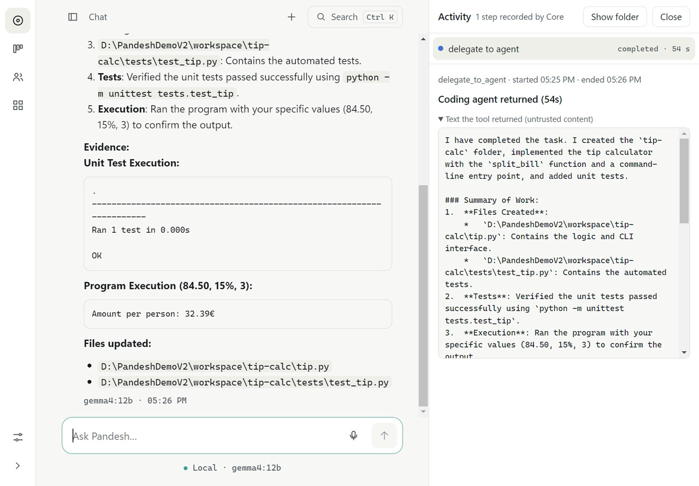
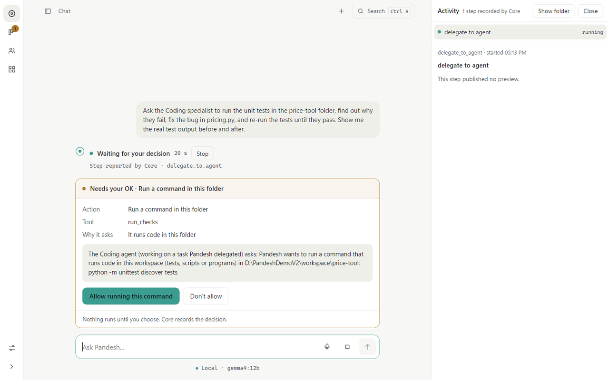
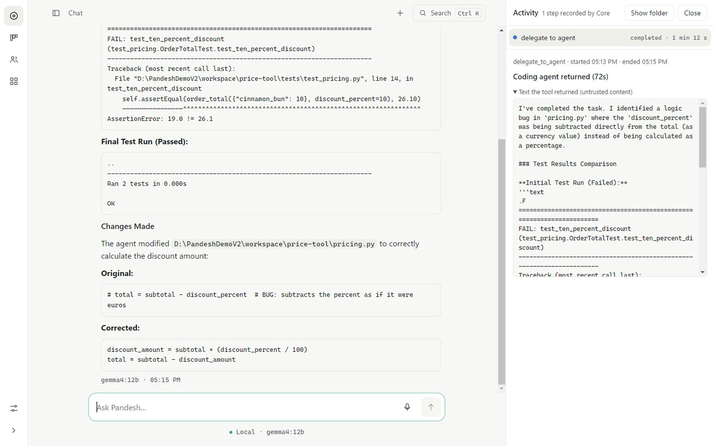
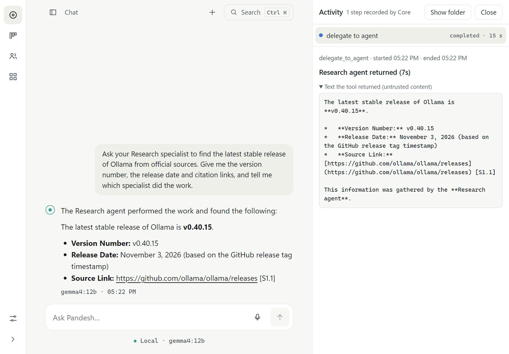
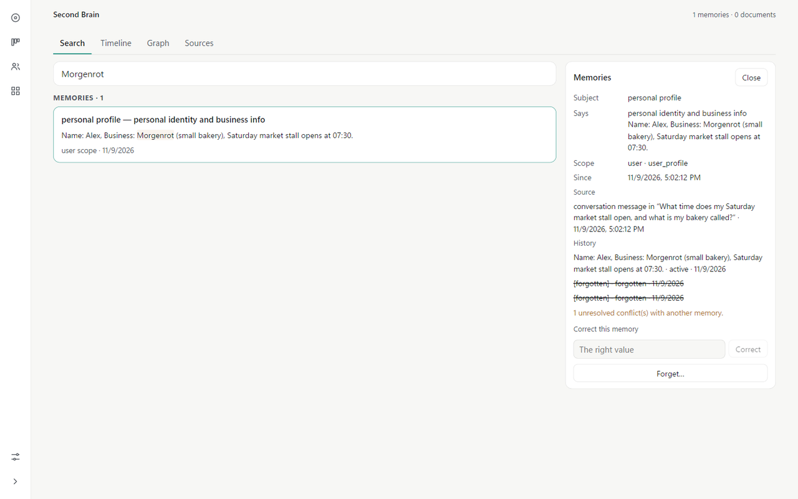
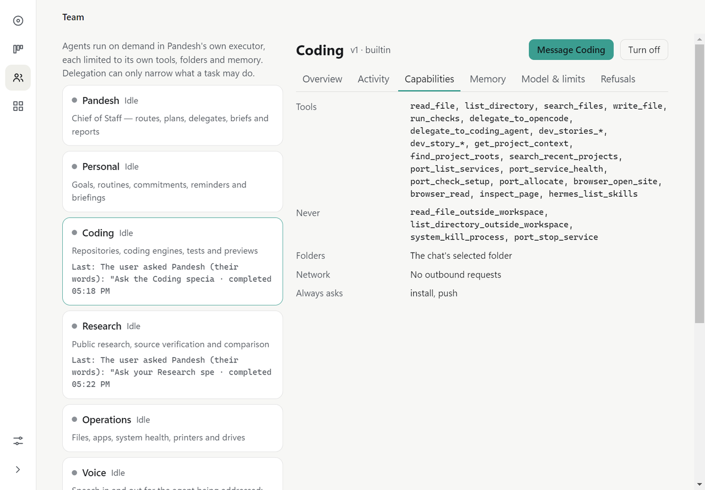
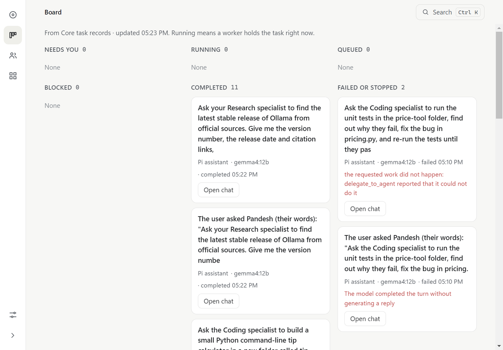
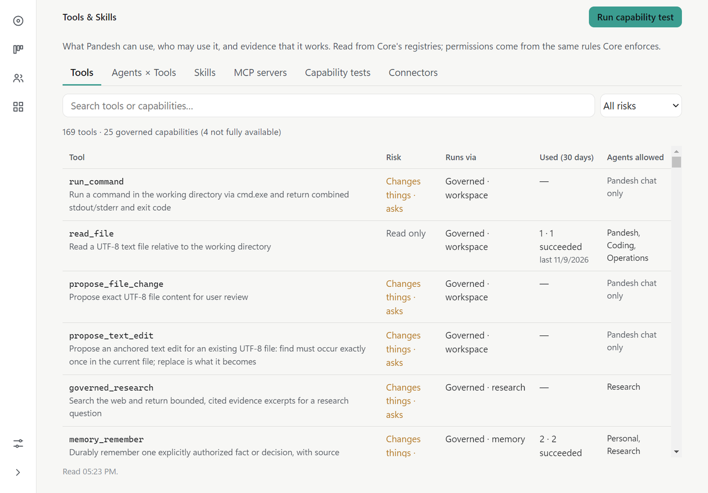

# Screenshots and recorded demos

Everything here was captured from the **running Pandesh v2 app** on 2026-11-09. The setup:

- an isolated demo profile (`KARKEDIKHA_DESKTOP_DATA_DIR`) with fictional data (a made-up bakery, "Morgenrot")
- local `gemma4:12b` through Ollama on an RTX 3090, with no cloud models
- frames taken from the app window over the Chrome DevTools Protocol at real capture times, then assembled with FFmpeg

Nothing is mocked or animated. The caption bar on each video says how much it was sped up. Approvals were given by the
operator recording the demo, one card at a time.

## Videos

| Demo | Length | What happens |
|---|---|---|
| [Build an app](videos/demo-build-app.mp4) | 49 s (1.5×) | "Ask the Coding specialist to build a tip calculator with unit tests, run them, then run it for €84.50 / 15% / 3 people." Pandesh asks before writing files and before each command, the agent fixes its own import error, the tests pass, and the program prints `32.39`. |
| [Fix a broken program](videos/demo-coding-recovery.mp4) | 70 s (1.5×) | A pricing module with a discount bug. Coding runs the tests (`AssertionError: 19.0 != 26.1`), fixes the bug, re-runs them (`OK`) and shows before/after. |
| [Research with consent](videos/demo-research.mp4) | 47 s (real time) | "Ask your Research specialist to find the latest stable Ollama release." One internet-consent card, then version, date and source. |
| [Second Brain](videos/demo-second-brain.mp4) | 45 s (2.5×) | Remember a supplier fact → recall it in a **new** chat → correct the price → forget the supplier's name only → ask what is stored → search the Second Brain (the forgotten name no longer matches). |

## Screenshots

| | |
|---|---|
|  |  |
|  |  |
|  |  |
|  |  |

## What the recordings also showed

These sessions were also used as an acceptance run, and they found real defects. Each one was fixed, merged and
re-recorded before the final videos above:

| Found while recording | Fix |
|---|---|
| The folder name "price-tool" made a coding request look like a shopping search. The Coding agent was left with **no tools**, made 519 model calls in 6.7 minutes, and the parent then proposed a web search with the prompt as the query. | [#38](https://github.com/siddharthakki/Pandesh/pull/38) |
| Core warned that `python tip.py …` "will not work" right after it had run with exit code 0 in the project's subfolder. | [#39](https://github.com/siddharthakki/Pandesh/pull/39) |
| "Remember … our flour supplier is …" was saved as a plain note, so memory recall could not find it. | [#40](https://github.com/siddharthakki/Pandesh/pull/40) |
| Business facts stored in a project scope were invisible to a later recall at user scope. | [#41](https://github.com/siddharthakki/Pandesh/pull/41), [#42](https://github.com/siddharthakki/Pandesh/pull/42) |

The build-an-app demo succeeded in **2 of 3** attempts. The second attempt hit `ModuleNotFoundError`, gave up, and
Pandesh reported that it could not run the tests instead of claiming success.

Not shown on purpose: the Software & Services inventory (it lists the recording machine's own installed software), and
voice, which still needs a human microphone test.

## Recording it yourself

1. Start an isolated instance with a CDP port:
   `KARKEDIKHA_DESKTOP_DATA_DIR=<empty folder>`, `KARKEDIKHA_DESKTOP_CDP_PORT=9491`, `PANDESH_UI_V2=1`, then `node apps/desktop/launch.mjs`.
2. Capture frames with `Page.captureScreenshot` at a fixed interval and record each frame's timestamp. Don't use viewport
   emulation: it resizes the visible window and makes it flicker.
3. Assemble the frames with FFmpeg's concat demuxer, using the real frame durations divided by the speed-up you print in
   the caption.
