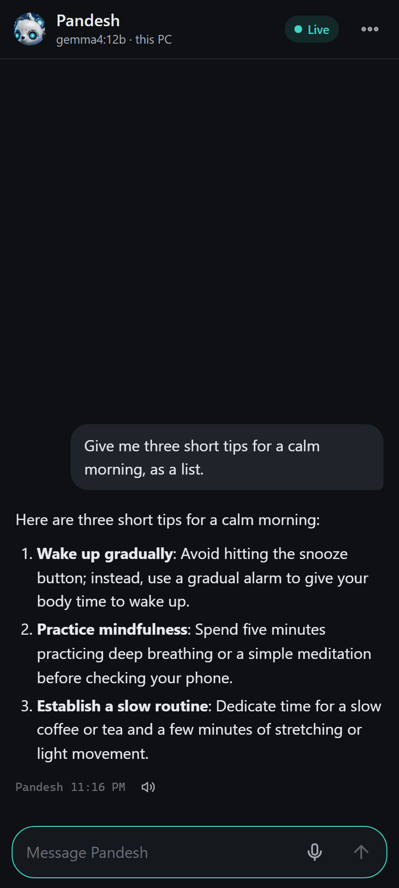
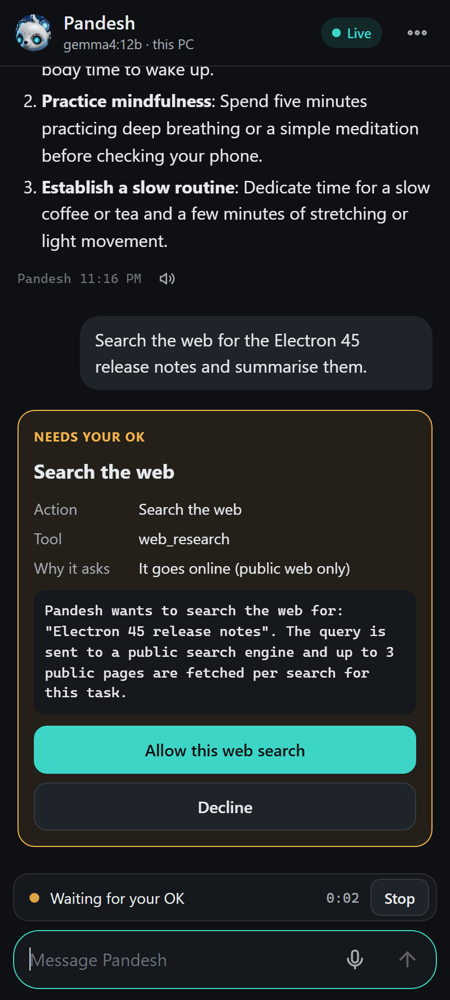
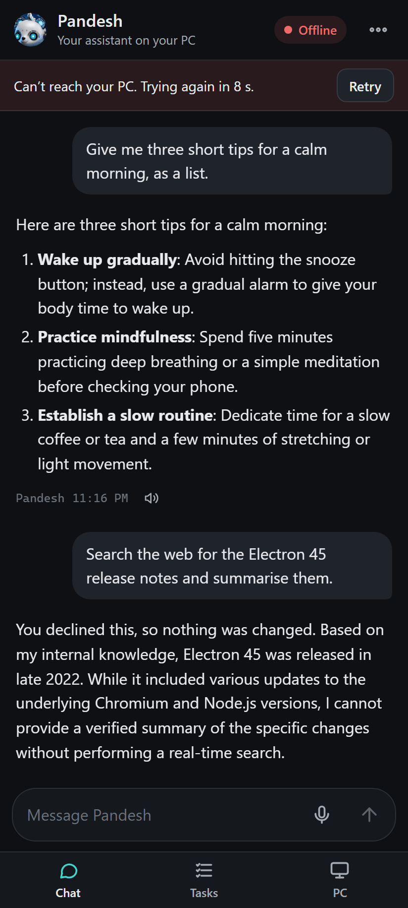
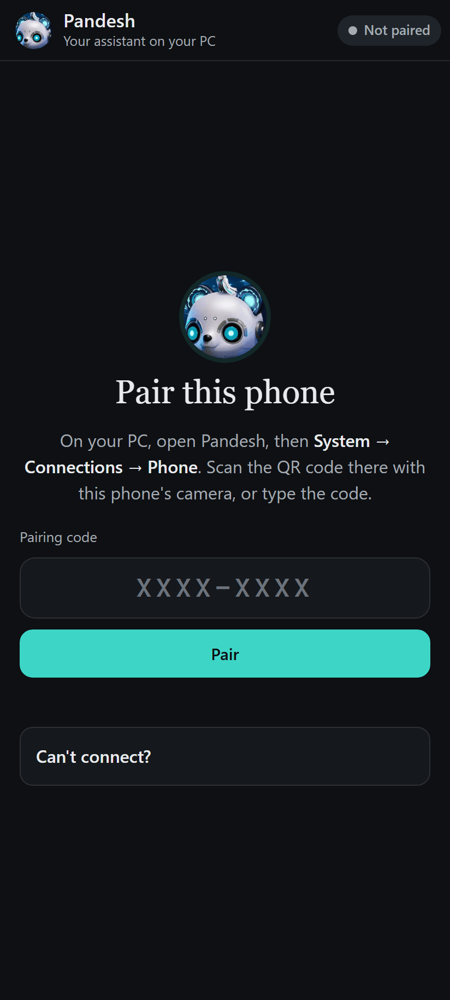
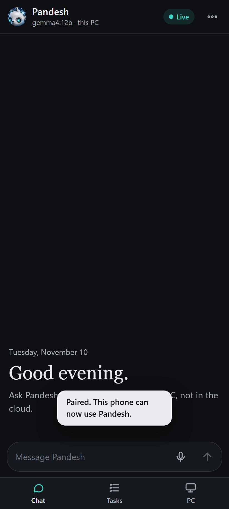
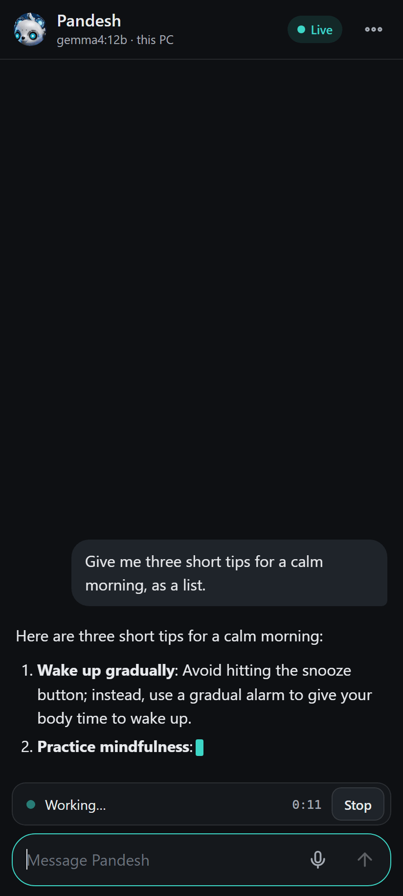
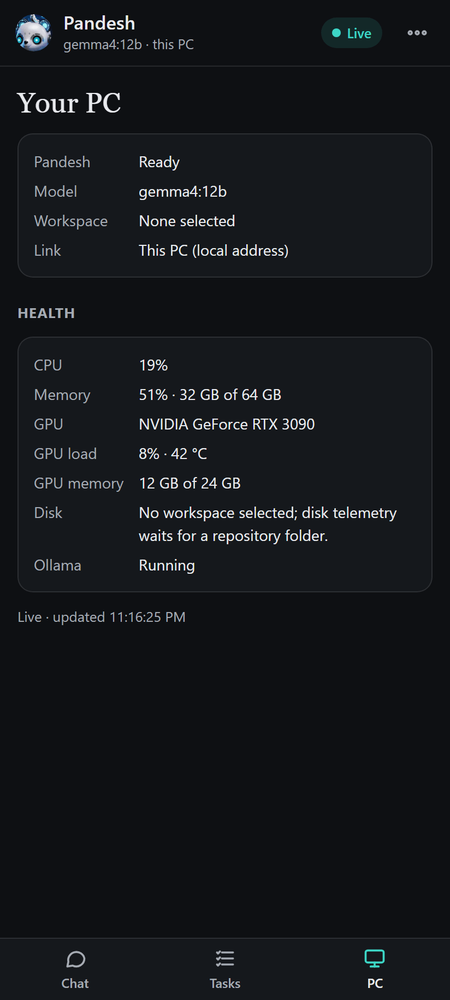
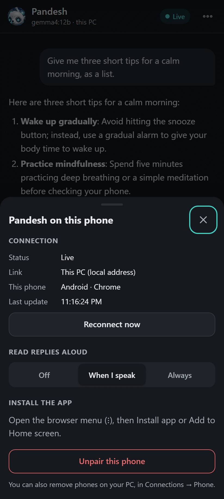

# Pandesh Mobile

Pandesh on your phone. You can chat with Pandesh, watch what it is doing, answer the approvals it asks for, take the decisions on development tasks, and see how your PC is doing. The Pandesh desktop app on your PC serves the phone app, and nothing runs in the cloud.

<p>
  
  
  
</p>

## Connect your phone with Tailscale (recommended)

Tailscale gives the phone a private, encrypted link to the PC. It also works on mobile data, and the address stays the same. It provides real HTTPS, which phones require before they allow the microphone or installing the app.

1. Install Tailscale on the PC and on the phone, and sign in with the same account on both.
2. In the Tailscale admin console, on the DNS page, turn on **MagicDNS** and **HTTPS Certificates**.
3. Give the PC a neutral name there, for example `desktop-1` (Machines → ⋯ → Edit machine name). HTTPS certificates are listed in public Certificate Transparency logs, so the name should not contain your name.
4. On the PC, run:

   ```
   tailscale serve --bg http://127.0.0.1:3030
   ```

   Never use `tailscale funnel`, which would put Pandesh on the public internet. Pandesh refuses requests that arrive through Funnel.
5. In Pandesh (v2), open **System → Connections → Phone**. The card shows the secure link and a QR code.
6. On the phone, turn Tailscale on. On Android it uses the VPN slot, so no other VPN can be on at the same time. Then scan the QR code with the camera. The phone pairs at once.
7. To install the app, open Chrome's menu (⋮) and choose **Install app** (or **Add to Home screen**).
8. Optional: in the Phone card, choose **Tailscale only**. Pandesh then listens on `127.0.0.1` only, so the Tailscale link is the only way in.

## Home Wi-Fi only

Without Tailscale, a phone on the same Wi-Fi opens `http://<PC address>:3030`. The Phone card shows that link and a QR code for it. Chat, approvals, tasks and PC status all work. Phones do not allow the microphone or installing the app on a plain `http://` address, so the app explains this instead of trying.

## If the phone cannot reach the PC

1. Is Pandesh running on the PC? Is phone access on (Phone card → *Who can reach Pandesh from a phone*)?
2. With the secure link, is Tailscale on in the phone's Tailscale app?
3. With the Wi-Fi link:
   - Is the phone on your main Wi-Fi, not a guest or IoT network?
   - Compare the phone's IP address (Wi-Fi details) with the PC's. The first three numbers must match. If they differ, a second router, a mesh extender or a guest network separates the two.
   - Turn off any VPN on the phone.
   - Router settings named "AP isolation", "client isolation" or "wireless isolation" block phones from reaching other devices.
4. On the phone, open `http://<PC address>:3030/api/status`. If a short line of JSON appears, the network path works and the problem is the pairing. Show a new code on the PC.

## How it stays private

- **Pairing.** The code has 8 characters, works once, and expires after 10 minutes. After 5 wrong codes from one device in 5 minutes, that device has to wait. After 20 wrong codes in total, pairing pauses for 15 minutes. You can allow it again on the PC.
- **Each phone has its own login.** It is an HttpOnly, SameSite=Strict cookie, marked Secure over HTTPS. The PC stores only a hash of it. A phone that has not been seen for 90 days is forgotten. The Phone card lists the paired phones, with **Forget** and **Forget all**.
- **Phones paired with an older build must pair again.** On its first start this build drops the old pairing code and every phone login stored by an older build, and keeps no copy of them. The host log records only how many were dropped.
- **Only this PC's own addresses.** A request must name the PC: an IP address, a local name, or the Tailscale name through `tailscale serve`. So a web page cannot reach Pandesh by DNS rebinding. Requests from other sites are refused (there is no CORS), and the app runs under a strict Content Security Policy.
- **No public internet.** Requests that arrive through Tailscale Funnel are refused, and the Phone card warns while Funnel is on.
- **Nothing about your conversations is stored on the phone.** The service worker caches only the app's own files. Conversations, approvals, audio and pairing always go to the PC.
- **Voice.** The phone records 16 kHz WAV audio, and the PC transcribes it with its local Whisper. Replies are read aloud by the phone's own voice: by default only for messages you spoke, or always or never if you choose.

## Screenshots

These are at Android phone size (412×915). They were taken against an isolated test copy of Pandesh, connected over the PC's own address.

| | | |
|---|---|---|
|  |  |  |
|  |  |  |
|  |  | |

The PC side (Connections → Phone):
- [The test copy](screenshots/pc-phone-card-test-instance.png), with no Tailscale and its one-time code hidden.
- [With Tailscale serving](screenshots/pc-phone-card-example-data.png), using example data: documentation addresses and an example tailnet name.

## For developers

| Part | Where |
|---|---|
| Server: routes and live events | `apps/desktop/src/host/mobileServer.ts` |
| Pairing codes and paired phones | `apps/desktop/src/host/mobilePairing.ts` |
| Rate limits | `apps/desktop/src/host/mobileRateLimit.ts` |
| Host, origin and Funnel checks; security headers | `apps/desktop/src/host/mobileHttpGuards.ts` |
| Tailscale link and home network address | `apps/desktop/src/host/mobileTailscale.ts` |
| What the phone sees of the session | `apps/desktop/src/host/mobileState.ts` |
| The app's files | `apps/desktop/src/host/mobileAssets.ts` serves `apps/desktop/renderer/mobile/` (no build step) |
| Icons | `node apps/desktop/scripts/build-mobile-icons.mjs` (from `assets/icon-512.png`) |
| PC card and QR code | `apps/desktop/renderer-v2/src/Phone.tsx`, `apps/desktop/renderer-v2/src/qr.ts` |
| Tests | `apps/desktop/test/mobile*.test.ts`, `qrEncoder.test.ts`, `uiV2PhoneCardRendererUi.test.ts` |

Environment variables:
- `KARKEDIKHA_MOBILE_PORT` (default 3030)
- `KARKEDIKHA_MOBILE_HOST` (overrides the listening address)
- `KARKEDIKHA_MOBILE_ALLOWED_HOSTS` (extra host names to accept, comma-separated)

Test and scratch profiles always listen on `127.0.0.1`.
